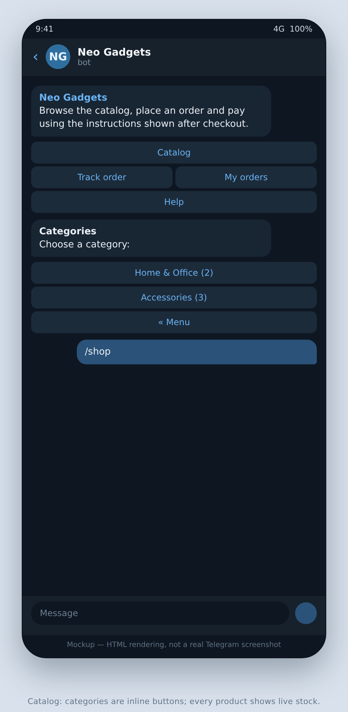
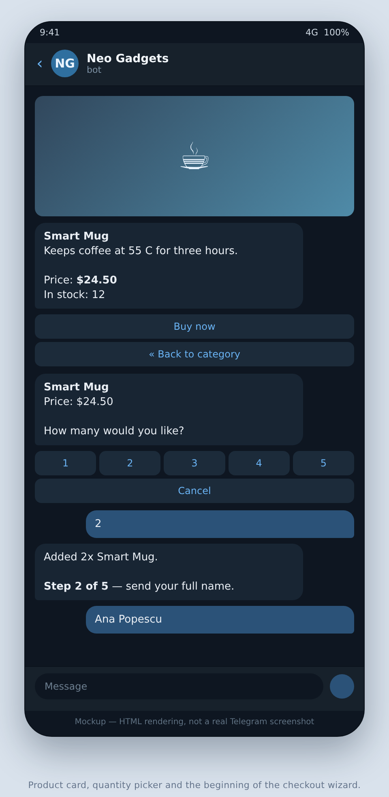
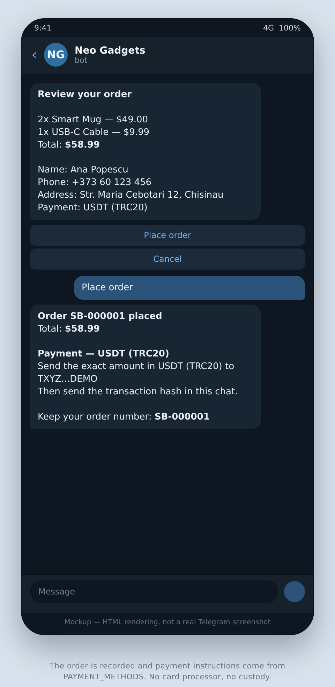
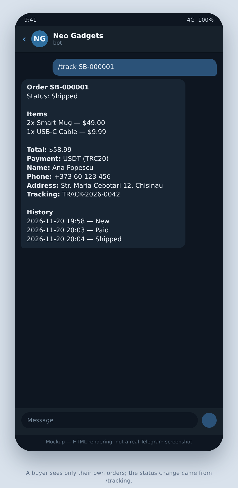
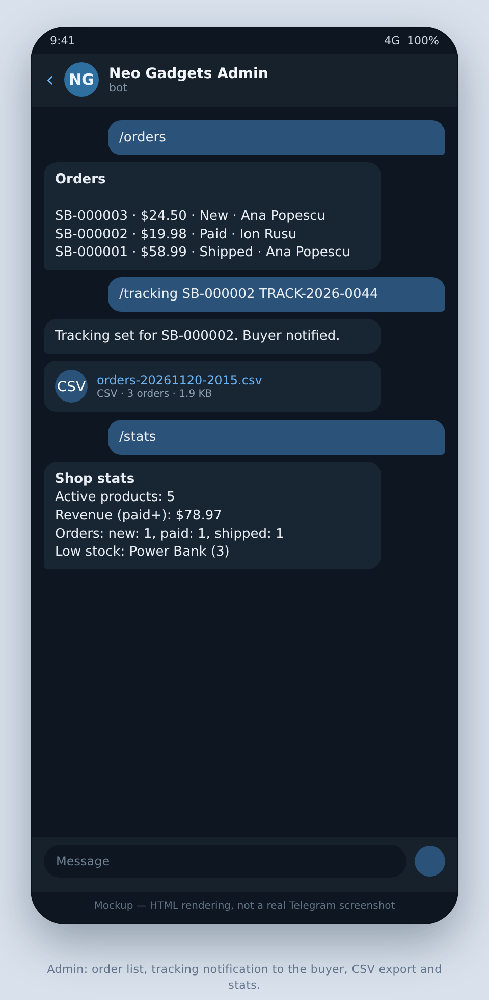

# Demo

This is an **offline, scripted walkthrough** of the exact service functions the
Telegram handlers call. It needs no bot token and makes no Telegram API calls.
The screenshots in `docs/screenshots/` are HTML mockups, clearly labeled as
such — they are not presented as real Telegram screenshots.

## Run it

```bash
python -m scripts.demo_walkthrough
```

Expected output (abridged):

```text
========================================================================
1. Seed catalog
========================================================================
[category] Accessories (1 products)
  #2 USB-C Cable — $9.99 · stock 40
[category] Home & Office (1 products)
  #1 Smart Mug — $24.50 · stock 12

========================================================================
2. Customer checkout (name / phone / address / payment)
========================================================================
Customer: Ana Popescu · +373 60 123 456 · Str. Maria Cebotari 12, Chisinau
Cart: 2x Smart Mug, 1x USB-C Cable

Order created: SB-000001
Order SB-000001
Status: New — awaiting payment

Items
• 2x Smart Mug — $49.00
• 1x USB-C Cable — $9.99

Total: $58.99
Payment: USDT (TRC20)
Name: Ana Popescu
Phone: +373 60 123 456
Address: Str. Maria Cebotari 12, Chisinau

Payment instructions (USDT (TRC20)):
Send the exact amount in USDT (TRC20) to TXYZ...DEMO
Then send the transaction hash in this chat.

========================================================================
3. Admin confirms payment and ships
========================================================================
admin> /setstatus SB-000001 paid USDT received
admin> /tracking SB-000001 TRACK-2026-0042
status now: Shipped

========================================================================
4. Customer tracks the order
========================================================================
...
Tracking: TRACK-2026-0042

History:
  2026-11-20T20:09:20Z  new  Order created
  2026-11-20T20:09:20Z  paid  USDT received
  2026-11-20T20:09:20Z  shipped  Tracking: TRACK-2026-0042

========================================================================
5. Another customer cannot see this order
========================================================================
lookup as user 888 -> None

========================================================================
6. Admin CSV export
========================================================================
order_number,created_at,status,customer_name,phone,...
SB-000001,2026-11-20T20:09:20Z,shipped,Ana Popescu,+373 60 123 456,...

========================================================================
7. Stats and low stock
========================================================================
{'orders_by_status': {'shipped': 1}, 'revenue_cents': 5899, ...}
```

## Screens

| Step | Image |
|---|---|
| Catalog and categories |  |
| Product, quantity, checkout |  |
| Order confirmation and payment instructions |  |
| Buyer tracking lookup |  |
| Admin orders, tracking, CSV and stats |  |

Regenerate them with `python -m scripts.make_mockups` (requires chromium).

## What to show a client in 10 minutes

1. Run the offline demo (`python -m scripts.demo_walkthrough`) — proves the
   order, stock, tracking and CSV logic without exposing a token.
2. Open the five screens and walk through the customer flow.
3. Show `/admin` in a test bot with the client's own catalog (needs their
   BotFather token).
4. Place one real test order, then run `/setstatus`, `/tracking` and `/export`.
5. Show the CI badge and `pytest -q` (72 tests).

## Notes for the sales conversation

- The $120 scope is catalog + orders + payment instructions + tracking + admin
  + CSV, one revision, delivered in 2 days after the client supplies the
  BotFather token, product list and payment details.
- Payment instructions are text only; the bot never holds funds or asks for card
  data. That keeps the build out of PCI scope and avoids custody risk.
- Delivery includes the private repo handoff (or transfer to the client's
  GitHub), `.env.example`, Docker files, README and a short handover call.
