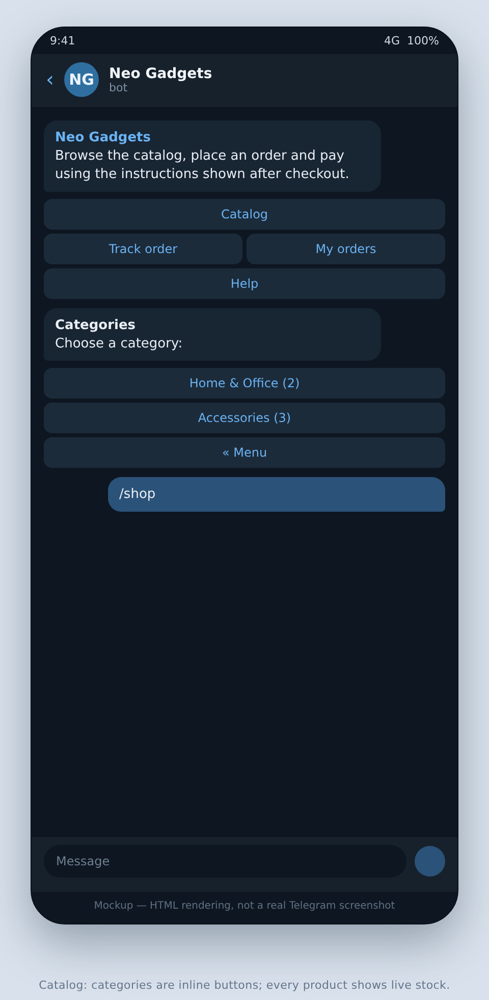
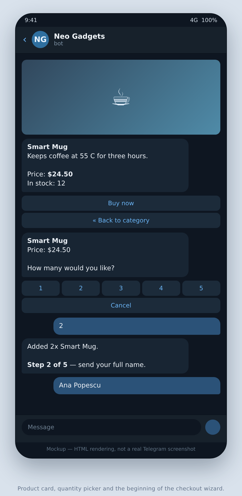
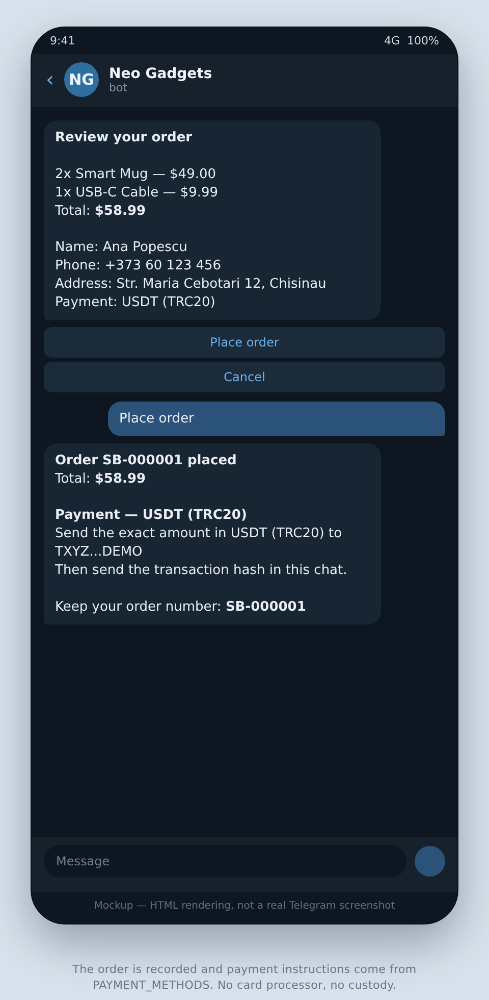
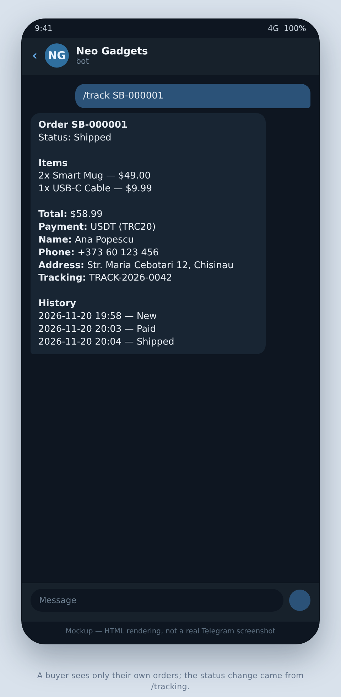
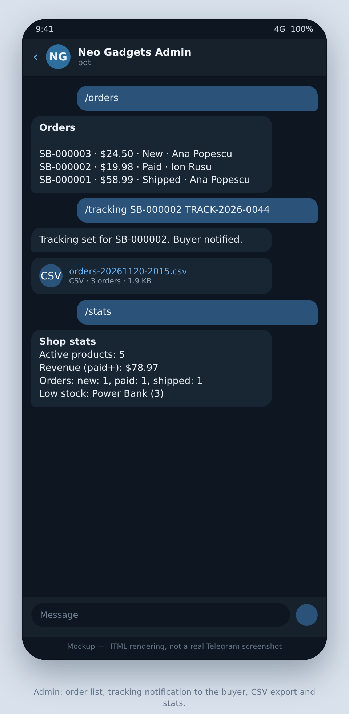
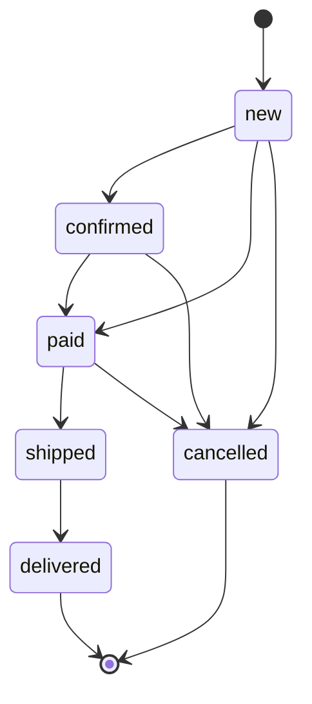

# Telegram shop bot template

A small, complete Telegram storefront you can hand to a client: product catalog,
checkout with name/phone/address, configurable payment instructions, order
tracking and an admin panel with CSV export.

Built with **Python 3.12**, **aiogram 3**, **SQLite (aiosqlite)** and no paid
services. No card processor, no custody of funds, no external APIs.

[](https://github.com/matrixneoaiagent/telegram-shop-bot/actions/workflows/ci.yml)

| Catalog | Checkout | Payment instructions |
|---|---|---|
|  |  |  |

| Tracking | Admin |
|---|---|
|  |  |

> The images above are **HTML mockups** of the bot screens, not screenshots of a
> live Telegram account. They are generated by `scripts/make_mockups.py` so the
> README stays accurate when the UI changes. See [DEMO.md](DEMO.md) for a real,
> offline terminal walkthrough of the same flow.

## Features

- **Catalog** — categories, names, descriptions, prices, stock and optional
  photo (`file_id` or HTTPS URL), managed entirely from Telegram.
- **Checkout** — product → quantity → name → phone → address → payment method →
  confirmation → order number (`SB-000001`).
- **Payment instructions** — configurable methods (USDT TRC20, BTC, cash on
  delivery, bank transfer, …). The bot records the order and prints the
  instructions; it never touches the money.
- **Tracking** — buyers run `/track SB-000001` and only see their own orders.
  An admin sets the tracking number; the buyer is notified automatically.
- **Admin** — add/edit products, set or adjust stock, hide products, list and
  inspect orders, change status, export a CSV, see revenue and low stock.
- **Safe defaults** — token and admin IDs come from environment variables;
  `.env` is git-ignored; tests run with a fake token and never call Telegram.
- **Tests and CI** — 72 pytest tests, `ruff check` + `ruff format --check` on
  Python 3.12 in GitHub Actions.

## Quickstart

```bash
git clone https://github.com/matrixneoaiagent/telegram-shop-bot.git
cd telegram-shop-bot

python3.12 -m venv .venv
source .venv/bin/activate
pip install -r requirements-dev.txt

cp .env.example .env
# edit .env: BOT_TOKEN from @BotFather, ADMIN_IDS from @userinfobot

python -m scripts.seed_demo     # optional demo catalog
python -m bot                   # start polling
```

Open the bot in Telegram, send `/start`, then `/admin` from an admin account.

### Run without a Telegram token

The service layer, the demo and the tests are fully offline:

```bash
python -m scripts.demo_walkthrough   # scripted catalog -> order -> tracking -> CSV
pytest -q                            # 72 tests, temp SQLite, fake token
```

## Environment variables

| Variable | Required | Default | Description |
|---|---|---|---|
| `BOT_TOKEN` | yes | — | BotFather token (`123456:ABC...`). |
| `ADMIN_IDS` | yes | — | Comma-separated numeric Telegram user IDs allowed to use admin commands. |
| `DB_PATH` | no | `shop.db` | SQLite file. Use a persistent volume in Docker. |
| `SHOP_NAME` | no | `My Shop` | Name shown in `/start` and help. |
| `SHOP_CURRENCY` | no | `USD` | Display currency for prices and totals. |
| `PAYMENT_METHODS` | no | cash on delivery | `key\|Label\|Instructions` entries separated by `;;` (see below). |
| `LOW_STOCK_THRESHOLD` | no | `5` | Products at or below this stock appear in `/stats`. |

`PAYMENT_METHODS` example (one line in `.env`):

```dotenv
PAYMENT_METHODS=usdt_trc20|USDT (TRC20)|Send USDT (TRC20) to YOUR_TRC20_ADDRESS\nThen send the transaction hash in this chat.;;btc|Bitcoin (BTC)|Send BTC to YOUR_BTC_ADDRESS\nThen send the transaction ID.;;cod|Cash on delivery|Pay in cash when your order arrives.
```

Use `\n` for a line break inside instructions. The bot shows these instructions
after the order is recorded; confirming payment is an admin action
(`/setstatus SB-000001 paid`), so no payment processor or wallet integration is
required.

## Architecture

```
bot/
├── main.py            # bot + dispatcher startup
├── config.py          # env parsing, payment methods
├── db.py              # SQLite schema and connection
├── services.py        # catalog, stock, orders, transitions, CSV
├── formatting.py      # HTML messages and money formatting
├── keyboards.py       # inline keyboards
├── states.py          # checkout FSM states
└── handlers/
    ├── catalog.py     # customer: catalog, checkout, tracking
    ├── admin.py       # admin commands and CSV export
    └── common.py      # admin filter, notifications

tests/                 # 72 offline tests
scripts/
├── seed_demo.py       # demo catalog
├── demo_walkthrough.py# offline end-to-end demo
└── make_mockups.py    # regenerate README screenshots (needs chromium)
```

The handlers are thin: all money, stock and state-transition rules live in
`services.py`, which is why the tests can cover the whole flow without Telegram.

### Data model

| Table | Purpose |
|---|---|
| `categories` | Category names, unique case-insensitively. |
| `products` | Price in integer cents, stock, photo, active flag. |
| `orders` | Customer details, payment method, status, total, tracking. |
| `order_items` | Snapshot of product name and price at purchase time. |
| `order_events` | Append-only status history for each order. |

Prices are stored as integer cents, never floats. Creating an order decrements
stock inside `BEGIN IMMEDIATE` with a `stock >= quantity` guard, so two buyers
cannot take the same last unit.

### Order statuses



Cancelling an order restores its stock. Setting a tracking number on a `paid`
order moves it to `shipped` and notifies the buyer. Status changes are recorded
in `order_events` and shown in `/order` (admin) and `/track` (buyer).

## Admin commands

| Command | Purpose |
|---|---|
| `/admin` | Help, payment methods, inline menu. |
| `/addcategory <name>` | Create a category. |
| `/addproduct Name \| 12.50 \| 10 \| Category \| Description` | Add a product. |
| `/editproduct <id> price\|stock\|name\|description\|category\|active <value>` | Edit a field. |
| `/setphoto <id> <file_id or URL>` | Set the product photo. |
| `/setstock <id> <qty>` / `/restock <id> <+/-qty>` | Set or adjust stock. |
| `/toggleproduct <id>` | Hide/show a product. |
| `/products` | List products with IDs and stock. |
| `/orders [status]` | Recent orders, optionally filtered. |
| `/order <number>` | Full order, items and status history. |
| `/setstatus <number> <status> [comment]` | Change status and notify the buyer. |
| `/tracking <number> <tracking>` | Set tracking, mark shipped, notify the buyer. |
| `/export [status]` | Download a CSV (UTF-8 with BOM for Excel). |
| `/stats` | Revenue, order counts and low stock. |

Buyer commands: `/start`, `/shop`, `/track <number>`, `/orders`, `/cancel`,
`/help`.

## Deployment

### Docker

```bash
cp .env.example .env      # fill in BOT_TOKEN and ADMIN_IDS
docker compose up -d --build
docker compose logs -f
```

The compose file keeps SQLite in the `shop-data` volume at `/data/shop.db`.
The image runs as an unprivileged user.

### VPS with systemd

```ini
[Unit]
Description=Telegram shop bot
After=network-online.target

[Service]
WorkingDirectory=/opt/telegram-shop-bot
EnvironmentFile=/opt/telegram-shop-bot/.env
ExecStart=/opt/telegram-shop-bot/.venv/bin/python -m bot
Restart=always
User=shopbot

[Install]
WantedBy=multi-user.target
```

`MemoryStorage` is used for the checkout wizard, so an in-progress checkout is
lost when the process restarts (placed orders are safe in SQLite). Use Redis
storage only if you need to survive restarts mid-checkout.

## Tests

```bash
pytest -q          # 72 passed
ruff check .
ruff format --check .
```

Coverage includes schema creation, category uniqueness, product validation,
stock decrement and rollback, concurrent last-unit purchases, cancellation
restocking, order state transitions, ownership-checked tracking lookup, CSV
export/filter/quotes, env parsing and router wiring. Tests use a temporary
SQLite file and a fake bot token; no network calls are made.

## Security notes

- The bot token is read from the environment and never logged or committed.
- Admin commands are filtered by numeric Telegram user ID.
- Buyers can only read orders whose `user_id` matches their own.
- All SQL uses parameters; all user-controlled text is HTML-escaped.
- No card data is collected, stored or forwarded.

**Limitations:** payment confirmation is manual (by design), there is no
multi-currency conversion, no refund automation, and a single bot process is
assumed. For high volume, move SQLite to Postgres and the FSM storage to Redis.

## License

MIT — see [LICENSE](LICENSE).
